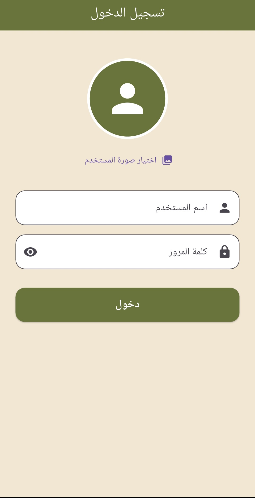
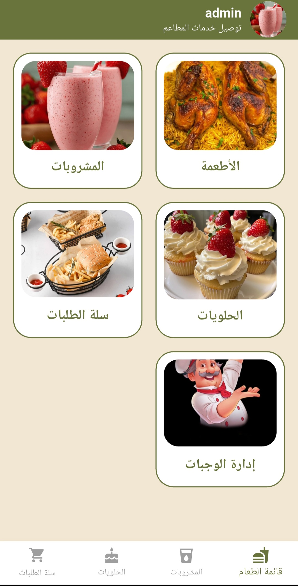
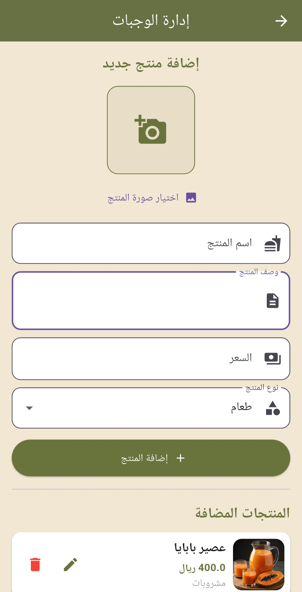
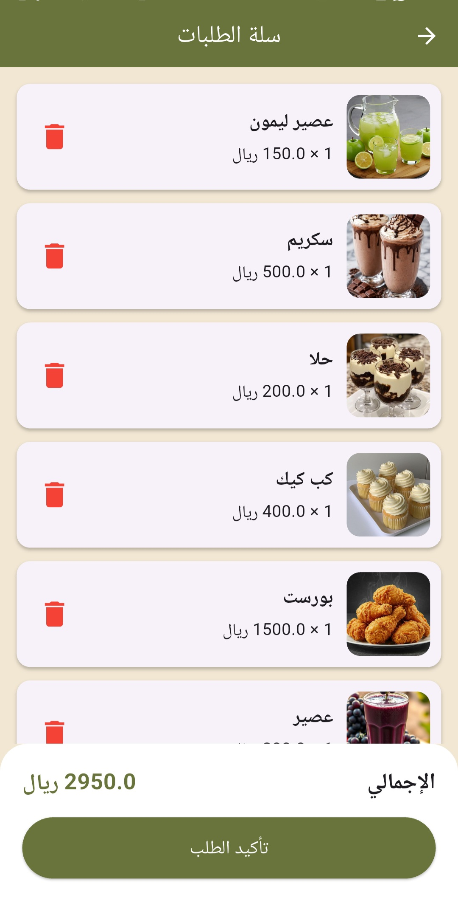

Restaurant Delivery App

A Flutter-based restaurant delivery application that allows users to browse food products, manage a shopping cart, and place orders. The application also includes an admin interface for managing products.

Features

User Features

- Browse available food products.
- View products by category.
- Add products to the shopping cart.
- Update product quantities and remove items.
- Calculate the total order price.
- Place orders and save order details.

Admin Features

- Admin and regular user roles.
- Add, edit, view, and delete products.
- Manage product information and categories.

Technologies Used

- Flutter – Cross-platform mobile application development.
- Dart – Programming language.
- GetX – State management and navigation.
- SQLite – Local database storage.
- sqflite – SQLite database integration.
- image_picker – Image selection.
- path_provider – Local file and directory management.

Database

The application uses a local SQLite database with the following tables:

- "users"
- "products"
- "cart"
- "orders"
- "order_items"

Getting Started

1. Clone this repository:
   
   git clone https://github.com/malakalgalal93-bot/final_project1.git

2. Navigate to the project directory:
   
   cd final_project1

3. Install dependencies:
   
   flutter pub get

4. Run the application:
   
   flutter run

Project Purpose

This project was developed as a practical application of Flutter and Dart concepts, focusing on mobile UI development, local database management, CRUD operations, and basic restaurant ordering workflows.

Developer

Malaak Al-Galal

Information Technology Student | Mobile Application Development Enthusiast

## Application Screenshots

### Login Screen

### Home Screen

### Products Management

### Shopping Cart

A new Flutter project.

## Getting Started

This project is a starting point for a Flutter application.

A few resources to get you started if this is your first Flutter project:

- [Learn Flutter](https://docs.flutter.dev/get-started/learn-flutter)
- [Write your first Flutter app](https://docs.flutter.dev/get-started/codelab)
- [Flutter learning resources](https://docs.flutter.dev/reference/learning-resources)

For help getting started with Flutter development, view the
[online documentation](https://docs.flutter.dev/), which offers tutorials,
samples, guidance on mobile development, and a full API reference.
